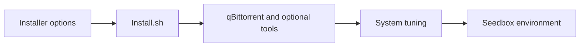

<div align="center">

# Dedicated Seedbox

**Build your seedbox, tune your environment.**  
*搭建下载环境，按需调整系统。*


<p align="center">
  <a href="#features">核心特性</a> •
  <a href="#quick-start">快速上手</a> •
  <a href="#workflow">工作流程</a> •
  <a href="#structure">项目结构</a> •
  <a href="#documentation">文档导航</a>
</p>

[简体中文](README-zh.md) · [English](README.md)

[仓库主页](https://github.com/langesmesser/Dedicated-Seedbox)

</div>

---

<a name="overview"></a>

## 项目简介

用于部署 qBittorrent 及可选配套工具的 Shell 安装脚本，包含缓存、版本、网络与系统参数调优说明。

本仓库是 [jerry048/Dedicated-Seedbox](https://github.com/jerry048/Dedicated-Seedbox) 的 Fork。下方保留本分支现有指南与原作者来源；上游发行内容不等同于本分支构建产物。

> 现有指南明确标注 BBR v3 不可用；安装脚本会修改系统，请先阅读参数和调优说明。

---

<a name="features"></a>

## 核心特性

<table>
  <tr>
    <td width="50%" valign="top">
      <h3>客户端安装</h3>
      <p>按参数选择 qBittorrent 与 libtorrent 版本。</p>
    </td>
    <td width="50%" valign="top">
      <h3>可选配套工具</h3>
      <p>按需安装 autobrr、vertex 与 autoremove-torrents。</p>
    </td>
  </tr>
  <tr>
    <td width="50%" valign="top">
      <h3>系统调优</h3>
      <p>提供 CPU、网络、内核和存储参数说明。</p>
    </td>
    <td width="50%" valign="top">
      <h3>平台说明</h3>
      <p>现有指南列出 Debian 10+、Ubuntu 20.04+、x86_64 与 ARM64。</p>
    </td>
  </tr>
</table>

---

<a name="workflow"></a>

## 工作流程



---

<a name="quick-start"></a>

## 快速上手

按下方指南选择与你的系统、客户端或部署方式相符的入口。安装与发行地址沿用本分支现有说明。

<a name="usage-guide"></a>

## 完整使用指南

### 用法
`bash <(wget -qO- https://raw.githubusercontent.com/jerry048/Dedicated-Seedbox/main/Install.sh) -u <用戶名稱> -p <密碼> -c <緩存大小(單位:MiB)> -q <qBittorrent 版本> -l <libtorrent 版本> -b -v -r -3 -x -o`
##### Options
	1. -u: 用戶名稱
	2. -p: 密碼
	3. -c: qBitorrent 的緩存大小
	4. -q: qBittorrent 版本
	5. -l: libtorrent 版本
	6. -b: 安裝autobrr
	7. -v: 安裝vertex
	8. -r: 安裝 autoremove-torrents
	9. -3: 啓動 BBR V3
	10.-x: 啓動 BBRx
	11.-o: 自定義端口
##### 範例
`bash <(wget -qO- https://raw.githubusercontent.com/jerry048/Dedicated-Seedbox/main/Install.sh) -u jerry048 -p YOUR_PASSWORD -c 3072 -q 4.3.9 -l v1.2.19 -v -x`

###### 解釋
	1. 用戶名稱 是 jerry048
	2. 密碼 是 YOUR_PASSWORD
	3. 緩存大小 是 3GB
	4. 安裝 qBittorrent 4.3.9 - libtorrent-v1.2.19
	6. 安裝 vertex
	7. 啓動 BBRx
### 支持平台
	1. 系統
		1. Debian 10+
		2. Ubuntu 20.04+
	
	2. CPU 架構
		1. x86_64
		2. ARM64

### 功能
###### 1. 盒子環境
	1.qBittorrent
	2.autobrr
	3.vertex
	4.autoremove-torrents
###### 2. 優化
	處理器優化
	網絡優化
	内核參數調配
	硬盤優化
	BBR V3 或 BBRx
#### 進階優化備注
- 緩存大小應該設置在機器内存大小的 1/4 左右. 假如你使用的是qBittorrent 4.3.x, 你需要考慮到内存溢出的問題并且設置緩存大小在機器内存大小的 1/8. 

- 異步 I/O 綫程數的基礎設定是 4， 這設定對HDD比較友好. 假如你使用的是SSD甚至是NVMe的話, 你可以調整此參數到 8 甚至到 16. 
	- 在qBittorrent 4.3.x 的話，你可以在高級選項欄目中更改此項設定. 
	- 在qBittorrent 4.1.x 的話, 你可以在 /home/$username/.config/qBittorrent/qBittorrent.conf 裏的 [BitTorrent] 欄目下加入 `Session\AsyncIOThreadsCount=8`
		- 請在修改前關閉qBittorrent
	- 在Deluge 的話，你可以通過[ltconfig](https://github.com/ratanakvlun/deluge-ltconfig/releases/tag/v0.3.1)更改此項設定
		- aio_threads=8

- 在一些 I/O 較差的機器，send_buffer_low_watermark, send_buffer_watermark & send_buffer_watermark_factor 這三項設定應該調低
	- 在qBittorrent 4.3.x 的話，你可以在高級選項欄目中更改此項設定. 
	- 在qBittorrent 4.1.x 的話，你可以在 /home/$username/.config/qBittorrent/qBittorrent.conf 裏的 [BitTorrent] 欄目下加入`Session\SendBufferWatermark=5120`, `Session\SendBufferLowWatermark=1024`和 `ession\SendBufferWatermarkFactor=150`
		- 請在修改前關閉qBittorrent
	- 在Deluge 的話，你可以通過[ltconfig](https://github.com/ratanakvlun/deluge-ltconfig/releases/tag/v0.3.1)更改此項設定
		- send_buffer_low_watermark=1048576
		- send_buffer_watermark=5242880
		- send_buffer_watermark_factor=150

- 在一些 CPU 較差的機器，tick_internal 應該調高來節省CPU指令周期
	- qBittorrent 暫時還沒為修改這設定
	- 在Deluge 的話，你可以通過[ltconfig](https://github.com/ratanakvlun/deluge-ltconfig/releases/tag/v0.3.1)更改此項設定
		- tick_interval=250

- 在/etc/sysctl.conf 設置的 TCP 緩存大小對於一些低端機器來説可能會太大。 請根據情況更改.
	- 在 /etc/sysctl.conf 文檔中也能找到別的優化備注

- 文件系統的話, 本人强烈推薦使用 XFS 
#### 嗚謝
qBittorrent 安裝 - https://github.com/userdocs/qbittorrent-nox-static

qBittorrent 密碼設置 - https://github.com/KozakaiAya/libqbpasswd & https://amefs.net/archives/2027.html

Deluge 密碼設置 - https://github.com/amefs/quickbox-lite

autoremove-torrents - https://github.com/jerrymakesjelly/autoremove-torrents

BBR 安裝 - https://github.com/KozakaiAya/TCP_BBR

---

<a name="structure"></a>

## 项目结构

```text
Dedicated-Seedbox/
├── Install.sh              # 安装与系统调优脚本
├── README-zh.md            # 中文使用指南
└── README.md               # 英文使用指南
```

---

<a name="documentation"></a>

## 文档导航

- [完整使用指南](#usage-guide)

---

<a name="contributing"></a>

## 参与贡献

反馈时请说明系统、版本、使用步骤、预期行为和脱敏日志。提交改动前核对相关指南与实际实现，并运行与改动有关的验证。

有关上游功能和发行的问题，可通过上方原作者入口反馈。

---

<a name="license"></a>

## 许可证与来源

本仓库未提供独立 LICENSE 文件；现有第三方组件与上游内容仍适用各自的许可和使用条款。

<div align="center">

### 项目活动

[](https://www.star-history.com/#langesmesser/Dedicated-Seedbox&Date)

[贡献记录](https://github.com/langesmesser/Dedicated-Seedbox/graphs/contributors)

</div>
