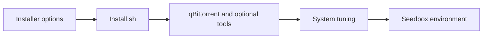

<div align="center">

# Dedicated Seedbox

**Build your seedbox, tune your environment.**


<p align="center">
  <a href="#features">Key Features</a> •
  <a href="#quick-start">Quick Start</a> •
  <a href="#workflow">Workflow</a> •
  <a href="#structure">Project Structure</a> •
  <a href="#documentation">Documentation</a>
</p>

[简体中文](README-zh.md) · [English](README.md)

[Repository](https://github.com/langesmesser/Dedicated-Seedbox)

</div>

---

<a name="overview"></a>

## Overview

A Shell installer for qBittorrent and optional companion tools, with cache, version, network and system tuning guidance.

This repository is a fork of [jerry048/Dedicated-Seedbox](https://github.com/jerry048/Dedicated-Seedbox). The branch's existing guides and author credits are retained; upstream releases are distinct from this branch's build artifacts.

> The existing guide marks BBR v3 as unavailable; read the options and tuning notes before running the system-modifying installer.

---

<a name="features"></a>

## Key Features

<table>
  <tr>
    <td width="50%" valign="top">
      <h3>Client installation</h3>
      <p>Choose qBittorrent and libtorrent versions through installer options.</p>
    </td>
    <td width="50%" valign="top">
      <h3>Optional companions</h3>
      <p>Install autobrr, vertex and autoremove-torrents when required.</p>
    </td>
  </tr>
  <tr>
    <td width="50%" valign="top">
      <h3>System tuning</h3>
      <p>Review CPU, network, kernel and storage tuning guidance.</p>
    </td>
    <td width="50%" valign="top">
      <h3>Platform guidance</h3>
      <p>The existing guide lists Debian 10+, Ubuntu 20.04+, x86_64 and ARM64.</p>
    </td>
  </tr>
</table>

---

<a name="workflow"></a>

## Workflow



---

<a name="quick-start"></a>

## Quick Start

Choose the path below that matches your system, client or deployment. Installation and release links follow this branch’s existing documentation.

<a name="usage-guide"></a>

## Complete Usage Guide

BBR v3 is currently unavailable

### Seedbox Installation Script
### Usage
`bash <(wget -qO- https://raw.githubusercontent.com/jerry048/Dedicated-Seedbox/main/Install.sh) -u <username> -p <password> -c <Cache Size(unit:MiB)> -q <qBittorrent Version> -l <libtorrent Version> -b -v -r -3 -x -o`
##### Options
	1. -u: username 
	2. -p: password
	3. -c: Cache size for torrent client
	4. -q: qBittorrent versions
	5. -l: libtorrent versions
	6. -b: Install autobrr
	7. -v: Install vertex
	8. -r: Install autoremove-torrents
	9. -3: Enable BBR V3
	10.-x: Enable BBRx
	11. Customize ports
##### Example
`bash <(wget -qO- https://raw.githubusercontent.com/jerry048/Dedicated-Seedbox/main/Install.sh) -u jerry048 -p YOUR_PASSWORD -c 3072 -q 4.3.9 -l v1.2.19 -b -r -x`

###### Explanation
	1. username is jerry048
	2. password is YOUR_PASSWORD 
	3. Cache size is 3GB
	4. Install qBittorrent 4.3.9 - libtorrent-v1.2.19
	5. Install autobrr
	6. Install autoremove-torrents
	7. Enable BBRx
### Supported Platform
	1. OS
		1. Debian 10+
		2. Ubuntu 20.04+
	
	2. CPU Architecture
		1. x86_64
		2. ARM64
### Functions
###### 1. Seedbox Environment
	1. qBittorrent
	2. autobrr
	3. vertex
	4. autoremove-torrents
###### 2. System Tunning
	CPU Optimization
	Network Optimization
	Kernel Values
	Drive Optimization
	BBRv3 or BBRx

#### Fine Tunning Note
- The Cache size should be set to around 1/4 of the machine total available ram. In case you opt for qBittorrent 4.3.x, you need to take account into memory leakage and set it to 1/8. 

- aio_threads default setting is 4 and should be good for HDD. For SSD or even NVMe server, you might consider increase it to 8 or even 16. 
	- For qBittorrent 4.3.x - 4.6.x you can change it in the advance setting tab. 
	- For qBittorrent 4.1.x, you can set it in /home/$username/.config/qBittorrent/qBittorrent.conf by adding `Session\AsyncIOThreadsCount=8` under [BitTorrent] section
		- Please shut down qBittorrent before the editing
	- For Deluge, you can install [ltconfig](https://github.com/ratanakvlun/deluge-ltconfig/releases/tag/v0.3.1) and edit through the plugins
		- aio_threads=8

- send_buffer_low_watermark, send_buffer_watermark & send_buffer_watermark_factor can be set to a lower value if you are running on a machine with poor I/O.
	- For qBittorrent 4.3.x you can change it in the advance setting tab. 
	- For qBittorrent 4.1.x, you can set it in /home/$username/.config/qBittorrent/qBittorrent.conf by adding `Session\SendBufferWatermark=5120`,`Session\SendBufferLowWatermark=1024`and`Session\SendBufferWatermarkFactor=150` under [BitTorrent] section
		- Please shut down qBittorrent before the editing
	- For Deluge, you can install [ltconfig](https://github.com/ratanakvlun/deluge-ltconfig/releases/tag/v0.3.1) and edit through the plugins
		- send_buffer_low_watermark=1048576
		- send_buffer_watermark=5242880
		- send_buffer_watermark_factor=150

- tick_internal default setting is 100 which can be too high for some weaker CPU. Consider changing it to 250 or 500.
	- Sadly there is no way to change this setting in qBittorrent
	- For Deluge, you can install [ltconfig](https://github.com/ratanakvlun/deluge-ltconfig/releases/tag/v0.3.1) and edit through the plugins
		- tick_interval=250

- A little bit more fine tunning notes can also be found in /etc/sysctl.conf

- For file system, I highly recommend using XFS 

#### Credit
qBittorrent Install - https://github.com/userdocs/qbittorrent-nox-static

qBittorrent Password Set - https://github.com/KozakaiAya/libqbpasswd & https://amefs.net/archives/2027.html

Deluge Password Set - https://github.com/amefs/quickbox-lite

autoremove-torrents - https://github.com/jerrymakesjelly/autoremove-torrents

BBR Install - https://github.com/KozakaiAya/TCP_BBR

---

<a name="structure"></a>

## Project Structure

```text
Dedicated-Seedbox/
├── Install.sh              # Installation and system tuning
├── README-zh.md            # Chinese usage guide
└── README.md               # Repository documentation
```

---

<a name="documentation"></a>

## Documentation

- [Complete Usage Guide](#usage-guide)

---

<a name="contributing"></a>

## Contributing

When reporting an issue, include the OS, version, reproduction steps, expected behavior and redacted logs. Check the relevant guidance and implementation, and run validation appropriate to your change.

For upstream features and releases, use the original project links retained above.

---

<a name="license"></a>

## License and Attribution

This repository does not contain a standalone LICENSE file. Third-party components and upstream content remain subject to their respective licenses and usage terms.

<div align="center">

### Project Activity

[](https://www.star-history.com/#langesmesser/Dedicated-Seedbox&Date)

[Contributors](https://github.com/langesmesser/Dedicated-Seedbox/graphs/contributors)

</div>
